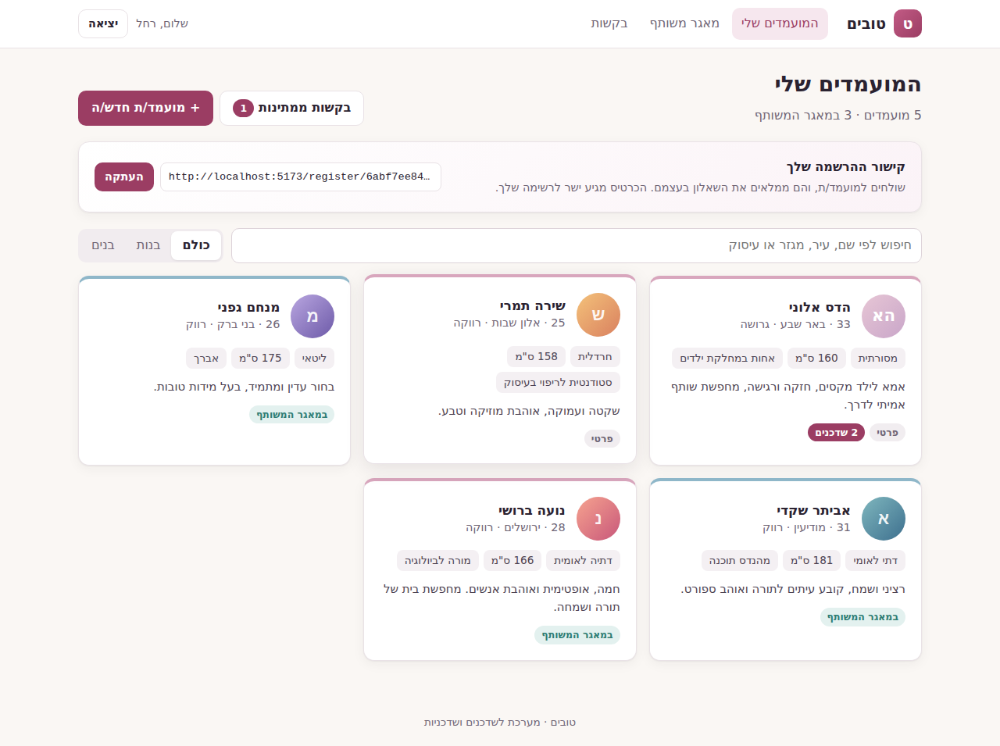
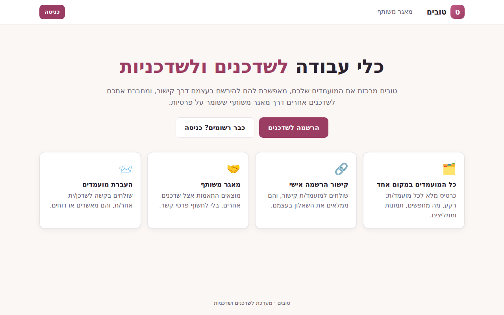
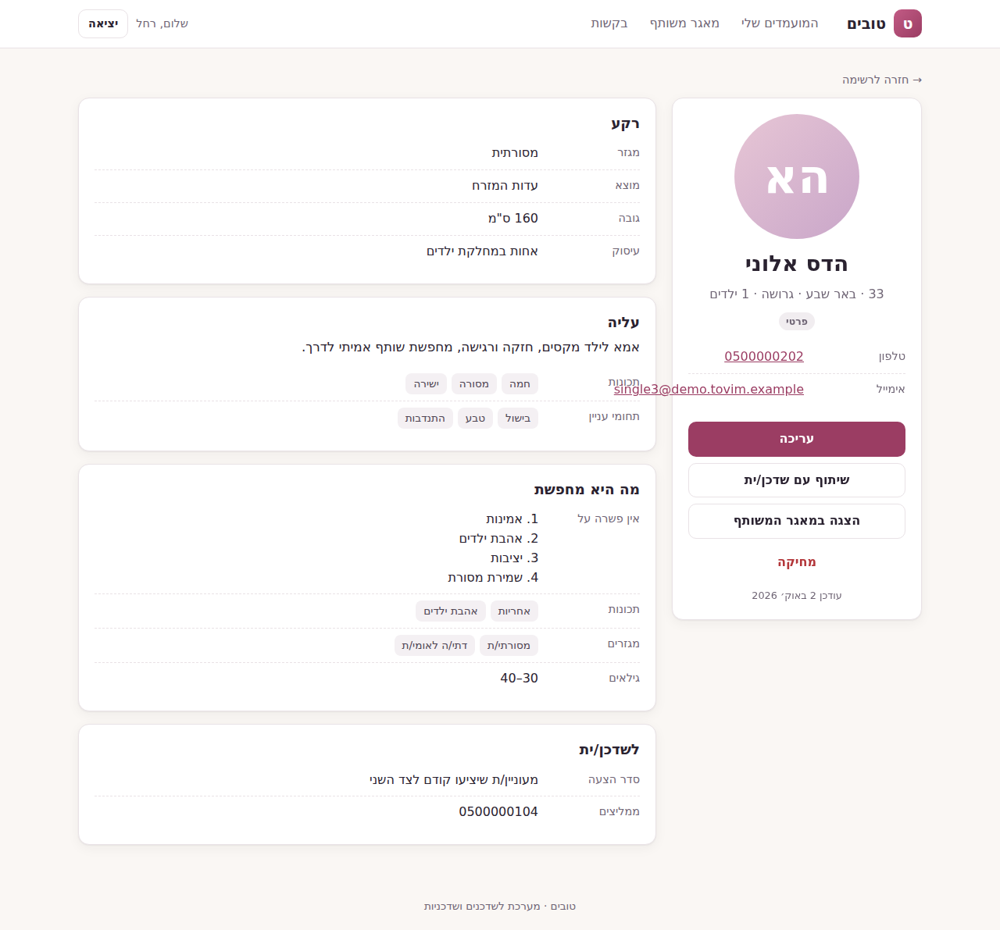
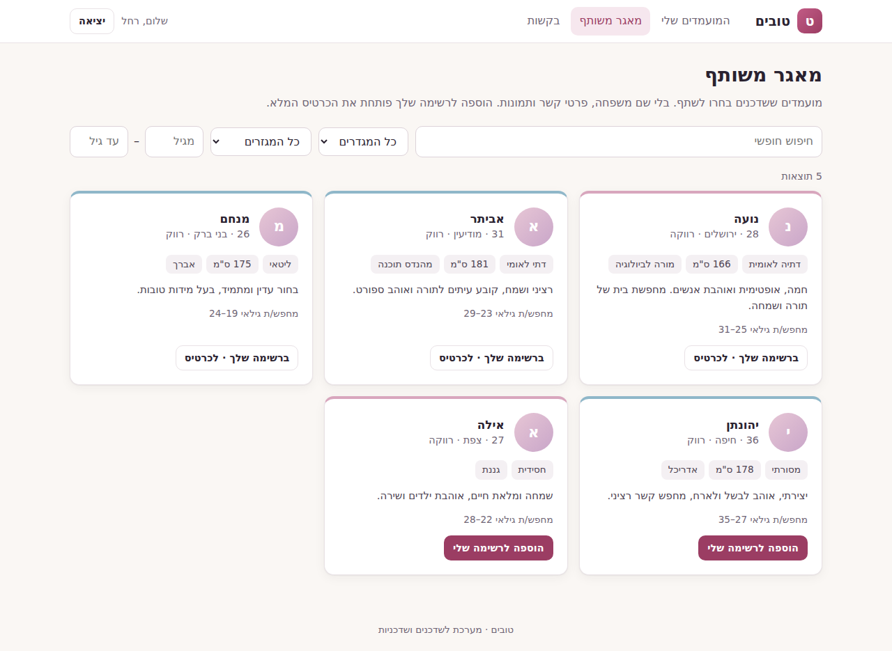
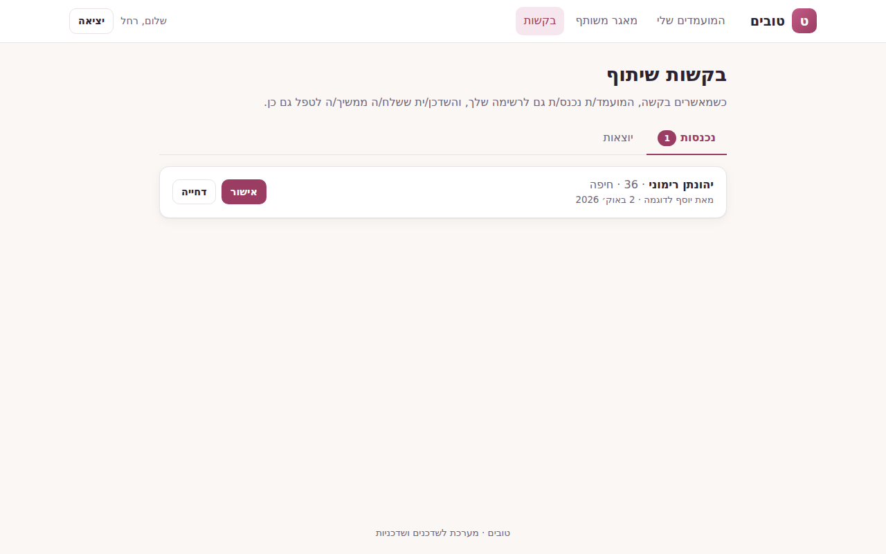
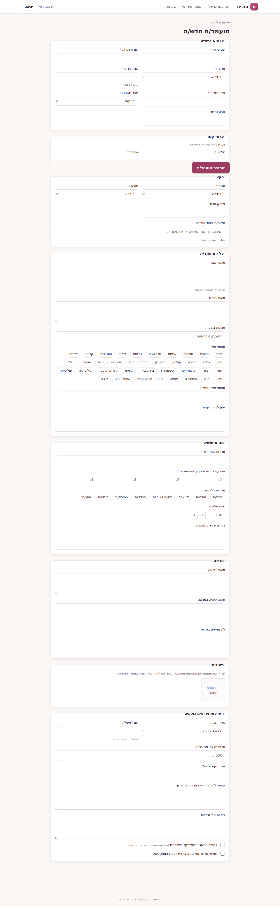
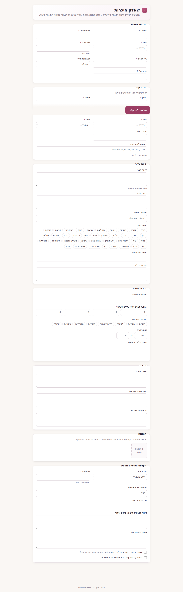
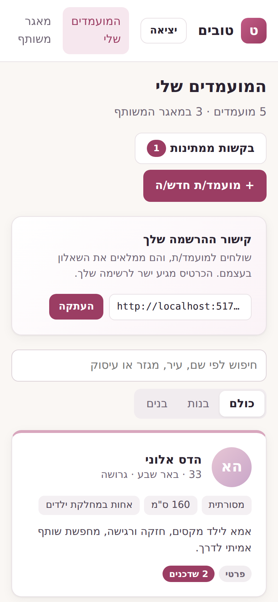
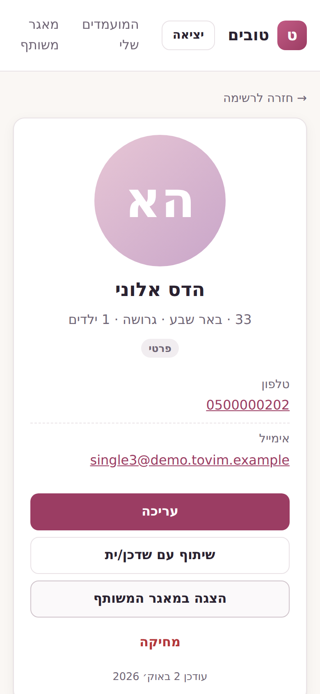
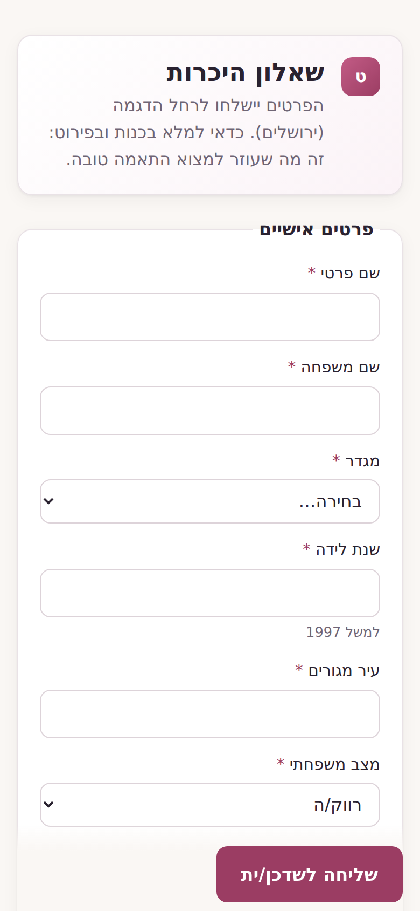

# טובים · Tovim

<div dir="rtl">

**טובים** היא מערכת עבודה לשדכנים ולשדכניות. היא מרכזת את כל המועמדים במקום אחד, מאפשרת למועמדים להירשם בעצמם דרך קישור אישי, ומחברת בין שדכנים דרך מאגר משותף ששומר על פרטיות.

</div>

A web app for Jewish matchmakers (shadchanim). Each matchmaker keeps a full profile for every single they work with, sends singles a personal sign-up link, browses a shared pool that hides contact details, and passes singles to other matchmakers through requests they can approve or reject. The interface is in Hebrew (RTL) and works on mobile.



## מה אפשר לעשות · Features

<div dir="rtl">

- **כניסה והרשמה לשדכנים**, עם סיסמאות מוצפנות (scrypt) וטוקן התחברות.
- **המועמדים שלי**: חיפוש לפי שם, עיר, מגזר או עיסוק, וסינון בנים ובנות.
- **כרטיס מועמד מלא**: רקע, תכונות, מה מחפשים, ממליצים ותמונה. עריכה, מחיקה ושיתוף.
- **שאלון מועמד** מלא עם בדיקות תקינות והקטנת תמונות בדפדפן.
- **קישור הרשמה אישי**: המועמד ממלא את השאלון בעצמו והכרטיס מגיע ישר לרשימה של השדכן.
- **מאגר משותף**: מועמדים ששדכנים בחרו לשתף, בלי שם משפחה, טלפון ותמונות. אפשר לסנן ולהוסיף לרשימה.
- **בקשות שיתוף**: שליחת מועמד לשדכן אחר, שמאשר או דוחה.

</div>

## צילומי מסך · Screenshots

| דף הבית · Landing | כרטיס מועמד · Single profile |
| --- | --- |
|  |  |
| **מאגר משותף · Shared pool** | **בקשות שיתוף · Transfer requests** |
|  |  |
| **שאלון מועמד · Single questionnaire** | **הרשמה עצמית · Self-registration** |
|  |  |

<p align="center">
  
  
  
</p>

All names and details in the screenshots are invented demo data from `npm run seed`.

## Architecture

```
client/   React 18 + React Router 7 + Vite 5 + TypeScript, plain CSS, RTL
server/   Express 4 + Mongoose 7 + TypeScript (ESM), MongoDB
```

- **API** (`server/src/routes`): `/auth` (login, logout), `/matchmakers` (sign up, `me`, public profile, singles, add from pool), `/singles` (CRUD, public pool, self-registration), `/requests` (incoming and outgoing transfer requests, approve, reject).
- **Security**: scrypt password hashes with per-user salt, hashed bearer tokens, field whitelists on every write, a safe projection for the public pool, CORS limited to `CLIENT_ORIGIN`, and a central JSON error handler.
- **Client** (`client/src`): `api/` mirrors the server models and maps server errors to Hebrew messages; `lib/singleForm.ts` converts between form state and the API payload and mirrors the server validation.
- **Tests**: 42 Vitest + supertest integration tests for the server (against a real MongoDB) and unit tests for the client form logic. GitHub Actions runs both on every push and pull request.

## Running locally

Requirements: Node 20 and Docker (for MongoDB).

```bash
docker run -d --name tovim-mongo -p 27017:27017 mongo:7

# Server on http://localhost:3000
cd server
cp .env.example .env
npm ci
npm run seed     # two demo matchmakers and eight invented singles
npm run dev

# Client on http://localhost:5173 (proxies /api to the server)
cd client
npm ci
npm run dev
```

Demo logins: `rachel@demo.tovim.example` or `yosef@demo.tovim.example`, password `demo-password`.

In production, build the client with `VITE_API_URL` pointing at the server, and set `MONGO_URI` and `CLIENT_ORIGIN` on the server.

### Tests

```bash
cd server && MONGO_URI=mongodb://127.0.0.1:27017 npm test
cd client && npm test
```

## License

[MIT](LICENSE)
