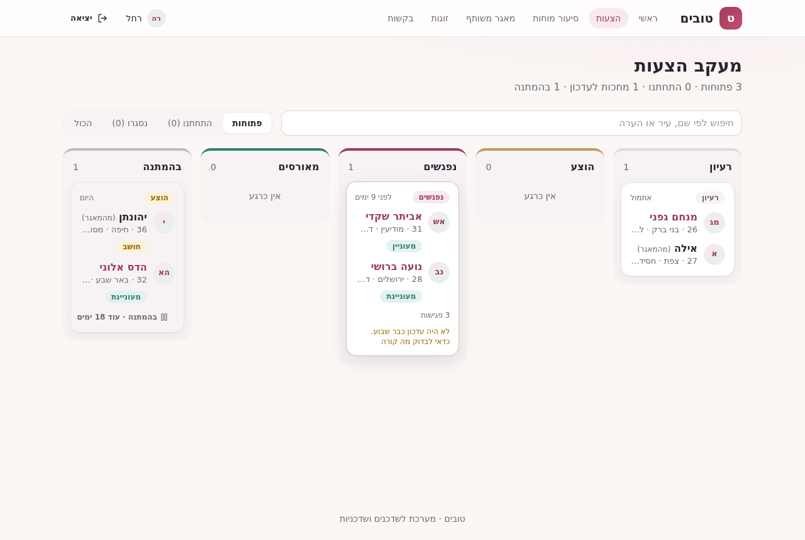
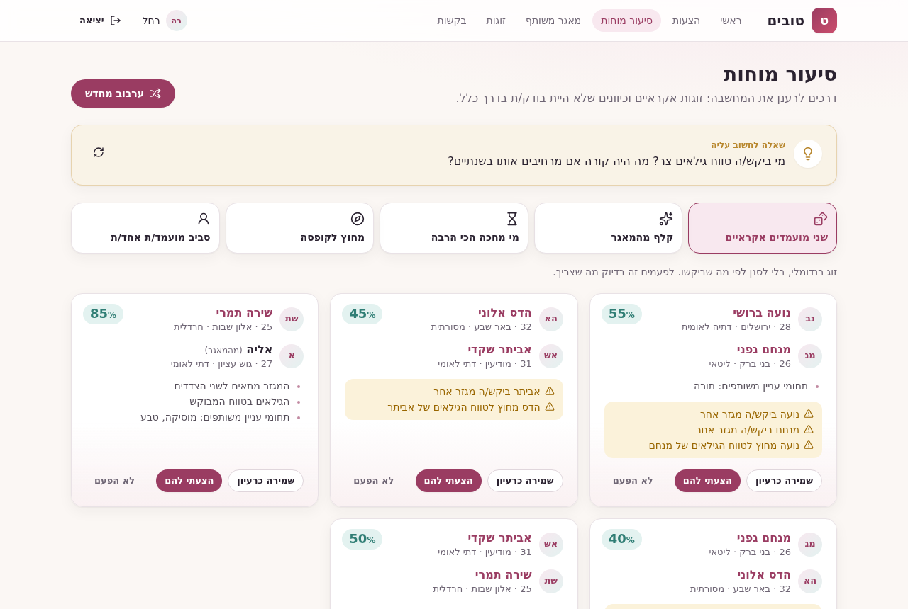
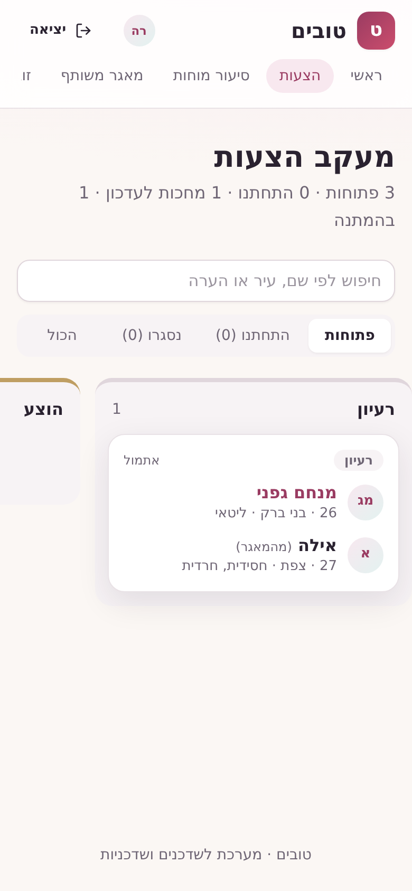

# טובים · Tovim

<div dir="rtl">

**טובים** היא מערכת עבודה לשדכנים ולשדכניות. היא מרכזת את כל המועמדים במקום אחד, עוקבת אחרי כל הצעה משלב הרעיון ועד החתונה, מציעה התאמות בעצמה, ומחברת בין שדכנים דרך מאגר משותף ששומר על פרטיות.

**גרסה חיה:** https://tovim.onrender.com (כניסת דמו בהמשך)

</div>

A web app for Jewish matchmakers (shadchanim). Each matchmaker keeps a full profile for every single they work with, tracks every proposal from first idea to wedding on a board, gets automatic match suggestions and a brainstorm mode for fresh ideas, sends singles a personal sign-up link, and shares singles with other matchmakers through a privacy-safe pool. The interface is in Hebrew (RTL), built with Tailwind and shadcn/ui, and works on mobile.

**Live demo:** https://tovim.onrender.com


## מה אפשר לעשות · Features

<div dir="rtl">

- **מסך ראשי**: מספרי מפתח, הצעות שמחכות לעדכון, והצעות אוטומטיות לזוגות לפי מגזר, גיל, עיר, מצב משפחתי ותחומי עניין, עם ציון התאמה והסבר.
- **מעקב הצעות**: לוח לפי שלבים (רעיון, הוצע, נפגשים, מאורסים, התחתנו, נסגרו), עם תשובה של כל צד, מספר פגישות, הערות והיסטוריה מלאה. הצעה שלא זזה שבוע מסומנת.
- **הצעה בהמתנה**: אפשר להקפיא הצעה עד תאריך, עם סיבה. היא עוברת לעמודת "בהמתנה" וחוזרת לבד בזמן, ותג בתפריט מראה כמה הצעות חזרו.
- **סיעור מוחות**: זוגות אקראיים וכיוונים מחוץ לקופסה, עם שאלה למחשבה, כדי לרענן את הרעיונות.
- **זוגות**: רשימת המועמדים שהתחתנו, כולל מי שסומנו דרך הצעה.
- **המועמדים שלי**: חיפוש לפי שם, עיר, מגזר או עיסוק, וסינון בנים ובנות.
- **כרטיס מועמד מלא**: כמה מגזרים, תאריך לידה (הגיל מחושב), רקע, תכונות, מה מחפשים, דברים שאין עליהם פשרות, תחומי עניין, ממליצים ותמונה, וכל ההצעות של המועמד.
- **קישור הרשמה אישי**: המועמד ממלא את השאלון בעצמו והכרטיס מגיע ישר לרשימה של השדכן. אפשר להעתיק את הקישור או לשלוח בוואטסאפ.
- **מאגר משותף**: מועמדים ששדכנים בחרו לשתף, בלי שם משפחה, טלפון ותמונות. אפשר לסנן, להוסיף לרשימה ולהציע ממנו.
- **בקשות שיתוף**: שליחת מועמד לשדכן אחר, שמאשר או דוחה.
- **כניסה והרשמה לשדכנים**, עם סיסמאות מוצפנות (scrypt), טוקן התחברות ודף פרופיל.

</div>

## צילומי מסך · Screenshots

| מעקב הצעות · Proposals board | סיעור מוחות · Brainstorm |
| --- | --- |
|  |  |
| **כרטיס מועמד · Single profile** | **דף הבית · Landing** |
|  |  |
| **מאגר משותף · Shared pool** | **בקשות שיתוף · Transfer requests** |
|  |  |
| **שאלון מועמד · Single questionnaire** | **הרשמה עצמית · Self-registration** |
|  |  |

On the board above, one proposal is on hold: it sits in the "בהמתנה" column with the days left until it comes back.

<p align="center">
  
  
  
  
</p>

All names and details in the screenshots are invented demo data from `npm run seed`.

## Architecture

```
client/   React 18 + React Router 7 + Vite 5 + TypeScript, Tailwind CSS + shadcn/ui, RTL
server/   Express 4 + Mongoose 7 + TypeScript (ESM), MongoDB
```

- **API** (`server/src/routes`):
  - `/auth`: login, logout.
  - `/matchmakers`: sign up, `me`, profile update, public card for the sign-up link, my singles, married singles, other matchmakers, add a single from the pool.
  - `/singles`: CRUD, bulk create (all or nothing), the public pool, self-registration.
  - `/proposals`: list, create, update status, sides, notes and hold, delete; `/proposals/suggestions` and `/proposals/brainstorm`.
  - `/requests`: incoming and outgoing transfer requests, approve, reject.
- **Matching** (`server/src/services`): `suggestions.ts` scores pairs by what each side asked for (sector, age range, city, marital status, shared interests) and explains the score; `brainstorm.ts` returns random and deliberately off-the-path pairs.
- **Data**: a single has several `sectors` and a `birthDate` (age is computed); a startup migration upgrades older records. A proposal keeps both sides' responses, its history and an optional `hold` until a date.
- **Security**: scrypt password hashes with per-user salt, hashed bearer tokens, field whitelists on every write, a safe projection for the public pool, CORS limited to `CLIENT_ORIGIN`, and a central JSON error handler.
- **Client** (`client/src`): `api/` mirrors the server models and maps server errors to Hebrew messages; `lib/` holds the form mapping, proposal and brainstorm logic with unit tests; `components/ui/` are the shadcn/ui primitives.
- **Tests**: 63 Vitest + supertest integration tests for the server (against a real MongoDB) and 24 unit tests for the client. GitHub Actions runs both, plus both builds, on every push and pull request.

## Running locally

Requirements: Node 20 and Docker (for MongoDB).

```bash
docker run -d --name tovim-mongo -p 27017:27017 mongo:7

# Server on http://localhost:3000
cd server
cp .env.example .env
npm ci
npm run seed     # two demo matchmakers, invented singles and a few proposals
npm run dev

# Client on http://localhost:5173 (proxies /api to the server)
cd client
npm ci
npm run dev
```

No Docker? Leave `MONGO_URI` empty and set `DEMO_MEMORY_DB=true` and `SEED_DEMO=true` in `server/.env`: the server starts an in-memory MongoDB with the demo data (it resets on every restart).

### Tests

```bash
cd server && MONGO_URI=mongodb://127.0.0.1:27017 npm test
cd client && npm test
```

## Deploying (Render + MongoDB Atlas)

The app deploys as one free Render web service from [`render.yaml`](render.yaml): the server serves the API under `/api` and the built client from `CLIENT_DIST`. Set `MONGO_URI` to a MongoDB Atlas connection string so data survives restarts; without it the service falls back to the in-memory demo database. With `SEED_DEMO=true` the demo data is loaded once, only when it is missing. Every push to `main` redeploys.

Step-by-step instructions in Hebrew are in [DEPLOY.md](DEPLOY.md).

## Demo logins

| Matchmaker | Email | Password |
| --- | --- | --- |
| רחל | `rachel@demo.tovim.example` | `demo-password` |
| יוסף | `yosef@demo.tovim.example` | `demo-password` |

These work on the live demo and on a locally seeded database.

## License

[MIT](LICENSE)
